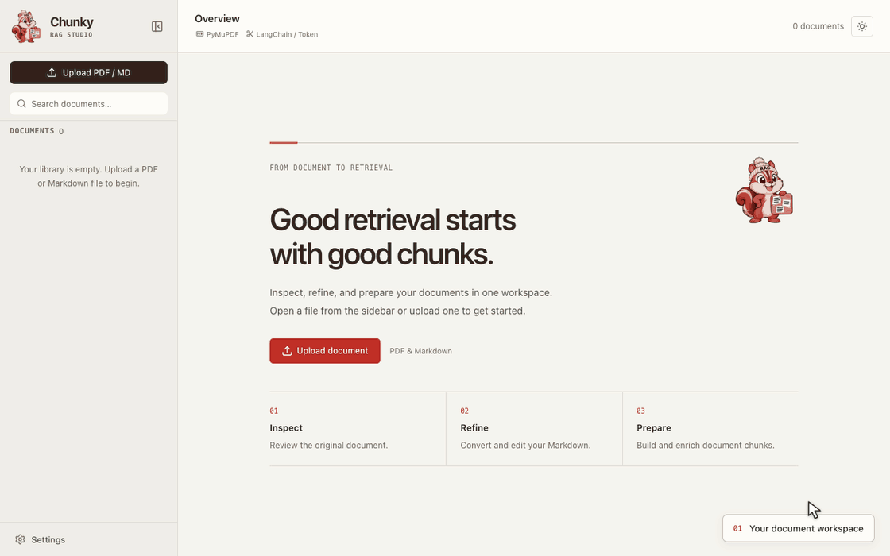
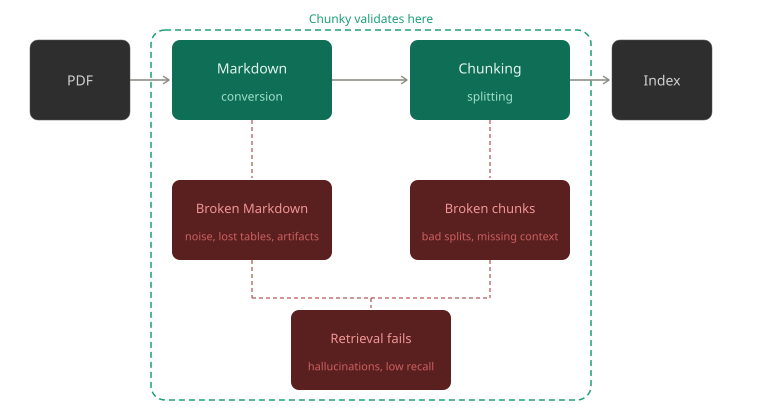

<p align="center">
  
</p>
<h1 align="center">Chunky</h1>
<p align="center">
    <strong>See what happens to your documents before they enter your RAG pipeline.</strong>
</p>
<p align="center">
  A local, open-source workspace to inspect PDF conversion, refine Markdown, compare chunking strategies, and review chunks before indexing.
</p>
<p align="center">
  <a href="#overview">Overview</a> ·
  <a href="#features">Features</a> ·
  <a href="#getting-started">Getting Started</a> ·
  <a href="#pdf-to-markdown-converters">Converters</a> ·
  <a href="#chunking-strategies">Chunking</a> ·
  <a href="#enrichment">Enrichment</a> ·
  <a href="#extending-chunky">Extending Chunky</a>
</p>
<p align="center">


</p>
<p align="center">
  
</p>

<p align="center">
  <strong>If you like this project, a star ⭐️ would mean a lot :)</strong>
</p>

---

## Overview

Broken tables, scrambled layouts, noisy Markdown, and poor chunk boundaries can undermine retrieval. Chunky makes those problems visible so you can inspect and fix the document before it reaches your vector store.

As [NVIDIA's research](https://developer.nvidia.com/blog/finding-the-best-chunking-strategy-for-accurate-ai-responses/) shows, no chunking strategy wins universally. Chunky helps you compare strategies on the actual document instead of treating chunking as a hidden parameter.

<p align="center">
  
</p>

> New to RAG? Check out [**Agentic RAG for Dummies**](https://github.com/GiovanniPasq/agentic-rag-for-dummies) — a hands-on implementation of Agentic RAG.

---

## Features

| | |
|---|---|
| 📄 **Document review workspace** | Compare PDF, Markdown, and chunks side by side before indexing |
| ✨ **Multiple conversion engines** | PyMuPDF, Docling, MarkItDown, LiteParse, VLM, and Cloud API support |
| 🔗 **Linked page navigation** | Navigate PDF and Markdown pages together, with page-aware scroll synchronization |
| 📤 **Bulk export** | Export selected documents or the whole workspace as a ZIP or to a backend folder |
| 📦 **Batch processing** | Convert, enrich, and chunk multiple documents from the sidebar |
| ✂️ **Chunking strategy comparison** | Test LangChain, Chonkie, and Docling splitters with configurable size and overlap |
| 💾 **Saved chunk versions** | Persist and reload chunk sets by Markdown source and splitter configuration |
| 🧠 **Markdown enrichment** | Clean conversion artifacts with deterministic cleanup plus LLM correction |
| ✨ **Chunk enrichment** | Generate context-aware titles, summaries, keywords, and retrieval questions |
| 🔌 **Pluggable backend** | Discover registered converters and splitters dynamically through the capabilities API |

Saved chunks remain available after Markdown edits; regenerate them to match the updated source.

---

## Getting Started

Two ways to run Chunky: locally or with Docker.

### Option 1 — Local

macOS, Linux, or WSL:

```bash
git clone https://github.com/GiovanniPasq/chunky.git
cd chunky
./start_all.sh
```

Windows PowerShell:

```powershell
git clone https://github.com/GiovanniPasq/chunky.git
cd chunky
.\start_all.ps1
```

### Option 2 — Docker
```bash
git clone https://github.com/GiovanniPasq/chunky.git
cd chunky
docker compose up --build
```

| Service  | URL                        |
|----------|----------------------------|
| Frontend | http://localhost:5173      |
| Backend  | http://localhost:8000      |
| Swagger  | http://localhost:8000/docs |

---

## PDF to Markdown Converters

No single converter wins on every document type. Chunky ships with six — switch between them in the UI and re-convert whenever you want to replace a converter's existing output.

| Converter | Library | Best for |
|-----------|---------|----------|
| **PyMuPDF** | `pymupdf4llm` | Fast conversion of standard digital PDFs with selectable text |
| **Docling** | `docling` | Complex layouts: multi-column documents, tables, and figures |
| **MarkItDown** | `markitdown[pdf]` | Simple, deterministic conversion of standard PDFs |
| **LiteParse** | `liteparse` | Fast, model-free PDF-to-Markdown parsing by LlamaIndex |
| **VLM** | `openai` + any vision model | Scanned PDFs, handwriting, diagrams — anything a human can read |
| **Cloud API** | `httpx` | POSTs the PDF to a configurable external endpoint and returns the Markdown response body directly |

PyMuPDF, Docling, LiteParse, and VLM support linked PDF/Markdown page navigation.
Use **Link pages…** to reconvert older output without page mapping. Other outputs
use approximate scroll sync; you can turn sync off for independent navigation.

### VLM converter

Connect any OpenAI-compatible vision model through Settings: model, base URL,
and optional API key. The default is local **Ollama**.

Docling and local vision models can be slow on CPU-only machines.
See the [Ollama FAQ](https://docs.ollama.com/faq#how-does-ollama-handle-concurrent-requests)
for concurrency and memory settings.

---

## Chunking Strategies

Chunky supports three splitting libraries, each exposing multiple strategies. The library and strategy are selected independently in the UI; size and overlap controls apply where the selected strategy supports them.

### LangChain (`langchain-text-splitters`)

| Strategy | Description |
|----------|-------------|
| **Token** | GPT-2 token windows that preserve complete Unicode characters. |
| **Recursive** | Tries Markdown structures, paragraphs, lines, words, and finally characters. Size and overlap are in characters. |
| **Character** | Splits on `\n\n` paragraphs, falls back to `chunk_size` characters. |
| **Markdown** | Splits by H1/H2/H3 headers, with an optional character size cap. |

### Chonkie

| Strategy | Description |
|----------|-------------|
| **Token** | GPT-2 token windows that preserve complete Unicode characters. |
| **Fast** | Fast byte-based splitting that preserves UTF-8 characters. No overlap. |
| **Sentence** | Keeps whole sentences with a character target and sentence-level overlap. Long sentences may exceed the target. |
| **Recursive** | Splits using structural delimiters (paragraphs → sentences → words) and a character target. No overlap. |
| **Table** | Splits Markdown tables into 3 data rows per chunk, repeats headers, and preserves surrounding prose. Size and overlap controls do not apply. |
| **Code** | Splits source code using AST structure and a character target; overlap does not apply. Requires optional `chonkie[code]` dependencies. |
| **Semantic** | Groups content by embedding similarity with a token target measured by the embedding model's tokenizer. Long sentences may exceed it. No overlap. |
| **Neural** | Uses a fine-tuned BERT model to detect semantic shifts; size and overlap controls do not apply. |

> **Note:** The **Semantic** and **Neural** strategies download ML models on first use and may be slow to initialise. Code chunking may also download parser grammars on first use.

Both Token strategies use GPT-2 encoding; your embedding model may count tokens differently. Overlap can shrink to preserve complete Unicode characters.

### Docling (`docling`)

| Strategy | Description |
|----------|-------------|
| **Hybrid** | Document-structure-aware chunking that respects headings, tables, and lists while enforcing a token limit. |
| **Line-Based** | Preserves line boundaries while enforcing a token limit. Best for tables, code, and logs where line integrity matters. |

> Both strategies may download a tokenizer on first use.

---

## Enrichment

### Markdown enrichment

Review and clean Markdown before chunking:

1. **Summary** *(optional)* — generate or review the document-level context before correction
2. **Cleanup** — removes conversion noise and repeated headers/footers while preserving code
3. **LLM correction** — preview suggested repairs before applying them

Single documents offer a review preview; bulk enrichment saves results automatically.

### Chunk enrichment

Enrich selected chunks or saved chunk sets in bulk. The model receives the chunk,
plus a document summary and nearby Markdown when available, and returns:

| Field | Description |
|-------|-------------|
| `cleaned_chunk` | Cleaned and normalized version of the original text |
| `title` | Short descriptive title for the chunk |
| `context` | One sentence describing where the chunk fits within the broader document |
| `summary` | One sentence summary of the chunk content |
| `keywords` | Array of relevant keyword strings |
| `questions` | Array of questions this chunk could answer |

Context and retrieval questions are inspired by
[Anthropic's Contextual Retrieval](https://www.anthropic.com/engineering/contextual-retrieval)
and the [Azure RAG enrichment guide](https://learn.microsoft.com/en-us/azure/architecture/ai-ml/guide/rag/rag-enrichment-phase).

---

## Extending Chunky

### Converters

Use an existing adapter in [backend/converters](backend/converters) as a reference.
Subclass `PDFConverter`, validate the input path, and return Markdown from
`convert(pdf_path, total_pages=None)`. Keep heavy library imports lazy.

```python
# backend/converters/my_converter.py
from pathlib import Path
from backend.registry import register_converter
from .base import PDFConverter

@register_converter(
    name="my_converter",
    label="My Converter",
    description="Short description shown in the UI.",
)
class MyConverter(PDFConverter):
    def __init__(self) -> None:
        from my_library import MyParser  # replace with your library's actual API
        self._parser = MyParser()

    def convert(self, pdf_path: Path, total_pages: int | None = None) -> str:
        self.validate_path(pdf_path)
        return self._parser.to_markdown(str(pdf_path))
```

Register the converter in:

- `@register_converter` and the imports in `backend/routers/capabilities_router.py`
- `ConverterType` in `backend/models/schemas.py`
- `_CONVERTER_MAP` in `backend/services/document_service.py`
- `CONVERTER_NORMALIZATION` in `backend/utils/naming.py`

For configurable options, update the request schema and `_build_converter`.
For page linking, use `page_markdown` from `backend/converters/pages.py` and
advertise `page_mapping=True` only when the adapter preserves source pages.

### Chunkers

Use [backend/chunkers](backend/chunkers) as a reference. For a new strategy,
add a `@register_chunker` method, a `ChunkerType` entry, and its class `_DISPATCH` entry.

For example, add this method inside `LangChainChunker`, using its existing imports:

```python
@register_chunker(
    library="langchain",
    library_label="LangChain",
    strategy="custom_recursive",
    label="Custom Recursive",
    description="Splits paragraphs and lines using a character budget.",
)
def _split_custom_recursive(self, request: ChunkRequest) -> list[ChunkItem]:
    splitter = RecursiveCharacterTextSplitter(
        separators=["\n\n", "\n", " ", ""],
        chunk_size=request.chunk_size,
        chunk_overlap=request.chunk_overlap,
    )
    return self.build_chunks(
        request.content, splitter.split_text(request.content),
        char_overlap=request.chunk_overlap,
    )
```

Add `custom_recursive` to `ChunkerType` and map
`ChunkerType.custom_recursive` to `_split_custom_recursive` in `_DISPATCH`.

For a new library, implement `TextChunker.chunk(request)` and add it to
`ChunkerLibrary`, `backend/chunkers/__init__.py`, `_LIBRARY_MAP` in
`backend/services/chunking_service.py`, capability discovery imports, and
`KNOWN_LIBRARIES` in `backend/utils/naming.py`.

Keep size units and overlap support consistent in `params_used_by` and
`frontend/src/utils/chunkingOptions.ts`. Source offsets use Python character
indices with an exclusive `end`; mark unavailable spans with
`metadata.source_span_available: false` and `start: 0, end: 0`.

Add dependencies to `pyproject.toml` and `requirements.txt`, update `uv.lock`,
and verify processing, saved versions, and export.
